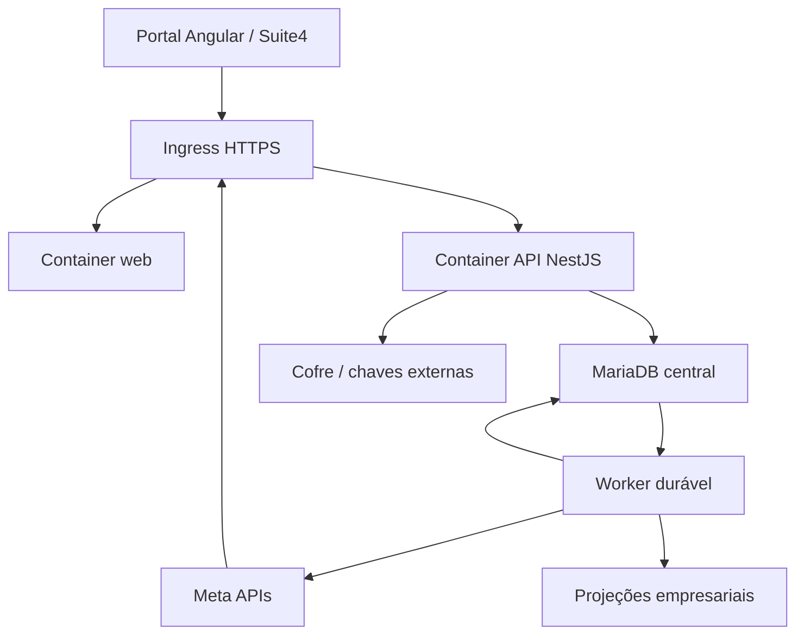

# Arquitetura proposta e decisões

As decisões abaixo são especificações para implementação, apoiadas no cenário atual e sujeitas aos experimentos/gates indicados. Não representam infraestrutura instalada. Angular é preservado; separar API e frontend continua requisito de produto.

## Topologia



Web e API são imagens/containers separados. Worker pode usar a imagem API com command próprio e escalar independentemente. Banco, eventual fila, ingress e telemetria são infraestrutura explícita. Dois containers de aplicação não eliminam essas dependências. Compose de host único é ponto inicial possível, não promessa de alta disponibilidade.

O origin público preferencial é único: `/` serve Angular e `/api` chega à API. Isso reduz complexidade de sessão e CORS. O modo embed ainda exige contrato Suite4 e alternativa top-level quando o navegador bloquear storage/cookies de terceiros.

A experiência completa de conversas continua no Msg4. Este repositório gere conexões, permissões, status e as funções já presentes; eventos/histórico são normalizados e entregues pelos contratos autorizados aos consumidores apropriados.

## Módulos e dependências permitidas

| Módulo | Responsabilidade | Não deve fazer |
|---|---|---|
| Identity/Tenancy | Sessão, membros, papéis, contexto imutável | Confiar em UUID/tenant de payload sem autorização |
| Onboarding | Sessões, state, checkpoints e saga | Acoplar success ao evento de janela ou manter transação durante Graph |
| Meta adapters | Autenticação/descoberta/operação por produto/variante | Usar token root como fallback genérico |
| Credentials | Cofre, ciclo e resolução por contexto | Expor segredo em DTO ou endpoint decrypt público |
| Assets | Relações, grants e estados observados | Fundir conta/número/canal/empresa por ExternalId global |
| Webhooks | Assinatura, inbox, roteamento e normalização | Executar regra pesada antes do ACK durável |
| Jobs | Leases, retries, outbox, dead-letter e replay | Repetir envio ambíguo sem política específica |
| LegacyBridge | Contratos S2S, mapeamento e projeções | Aceitar DB/DSN vindo do browser ou realizar transação distribuída fictícia |
| Audit/Operations | Evidência, retenção e diagnóstico | Guardar payloads e segredos sem necessidade |

Domínio não depende de framework, HTTP da Meta ou tabelas legadas. Aplicação coordena casos de uso. Adaptadores implementam portas de persistência, cofre, transporte, mensageria e consumidores. Controllers validam DTO/autorização e chamam casos de uso; workers invocam os mesmos casos com identidade de serviço controlada.

## ADRs M1.04 e tópicos de arquitetura relacionados

| ADR | Decisão inicial | Alternativas e consequência | Prova/gate |
|---|---|---|---|
| [001 · Stack](adrs/ADR-001-stack.md) | Angular preservado + NestJS 12; toolchains TypeScript por workspace | PHP modernizado é rota menor; Next.js não atende requisito identificado que justifique reescrever a UI | Faixas oficiais, toolchain isolada e build Nest no Node comum |
| [002 · Monorepo](adrs/ADR-002-monorepo.md) | npm workspaces com limites modulares | Nx/Turborepo só se o grafo/CI medir necessidade; M1 não reorganiza baseline | Lockfile prova workspaces, limites registrados para M2 |
| [003 · Persistência e jobs](adrs/ADR-003-persistence-jobs.md) | MariaDB + TypeORM explícito; inbox/outbox durável, polling worker | Redis/BullMQ adaptador opcional; DB segue fonte de intenção | PoC MariaDB de migration, JSON, índice, rollback, claim, crash/lease/redelivery e drain |
| [004 · Edge e sessão](adrs/ADR-004-edge-session.md) | Mesmo origin HTTPS; proxy roteia `/` e `/api` | Origins separados elevam CORS/cookie/CSRF; iframe precisa cenário próprio | M1 fixa a direção; Browser/Suite4/proxy real ficam gates posteriores |
| [005 · Segredos e legado](adrs/ADR-005-secrets-legacy.md) | Segredo central server-side; projeções empresariais sem token; bridge tipada | KMS/secret manager depois de owner/ambiente; legado continua referência até rollout | Nenhum valor operacional lido/ingressado; custody, DDL e deployment reais não confirmados |
| [006 · Rede de ingress Compose](adrs/ADR-006-compose-ingress-network.md) | `edge` conectado ao host para publicar somente web; `internal` segue isolada para o banco | Egress pelo `edge` e firewall do host ainda precisam de configuração/prova operacional | Smoke local verifica bind de loopback; isolamento LAN/firewall externo continuam **Not confirmed** |
| [007 · Limite de credencial de release](adrs/ADR-007-release-credential-boundary-and-retry-attestations.md) | Docker Hub auth existe só em steps dedicados a Docker/Buildx e verificação `gh`; retry reutiliza imagem apenas com atestações anteriores válidas | Shell de release mais explícito; credenciais, regras de tag e proteção real do ambiente seguem externas e não confirmadas | Gate de CI e revisões estáticas M2.09 no SHA candidato; publicação de registry não executada |

As primeiras cinco ADRs atendem ao pacote M1.04. Decisões sobre identidade Suite4, isolamento completo por tenant, variantes Meta, distribuição, migração e e-mail continuam especificadas como tópicos para suas issues M1/M2; a ADR-007 registra uma decisão de implementação da M2.09 sem afirmar que a infraestrutura esteja configurada. As ADRs desta etapa incluem contexto, opções, decisão, risco, consequência, verificação e condição de revisão. A [topologia de containers e responsabilidades](m1-04-container-topology.md) complementa a arquitetura sem afirmar que ela já está implantada.

## Organização alvo

```text
apps/web/                  Angular: sessão, catálogo, onboarding, conexões e funções atuais
apps/api/src/              Módulos NestJS, domínio, casos de uso e adaptadores
packages/contracts/        OpenAPI, schemas públicos e clientes gerados
database/migrations/       Migrações e ledger; sem synchronize em produção
specs/                     Regras, cenários, contratos e evidência por feature
docs/adr/                  Decisões versionadas
docs/runbooks/             Deploy, restore, reauth, retries, incidentes e migração
infra/docker/              Dockerfiles web/api e config de servidor estático
infra/compose*.yaml        Ambientes e dependências explícitas
.github/workflows/         CI, release e deploy conforme gates confirmados
AGENTS.md                  Índice de contexto e regras de trabalho
```

Nenhuma reorganização ocorre no PR de planejamento. Os caminhos acima são alvo da M2. Referências à baseline permanecem por SHA para evitar confundir diretórios futuros com código já existente.

## Estratégia de versões

Angular 21 estava em LTS na consulta de 28/10/2026 segundo [Angular releases](https://angular.dev/reference/releases). Não há necessidade de migrar imediatamente para a versão mais nova para resolver os problemas. Antes de implementar, selecionar patches/Node/TypeScript compatíveis em [Version compatibility](https://angular.dev/reference/versions) e registrar lockfile/base image. NestJS e bibliotecas de auth também exigem versão suportada verificada; a proposta não presume API disponível em uma versão antiga.

Versão da Graph API e versão do Embedded Signup são configurações diferentes e devem ser tratadas separadamente por modalidade. Não copiar `v24.0` do PHP nem uma versão citada no chat sem confirmação na matriz M1.03.

## Slice de implementação inicial

Depois da descoberta, o primeiro slice técnico deve atravessar autenticação de teste → tenant → API → estado de conexão sintético → contrato Angular → CI/imagem. A integração externa entra após cofre/state/worker seguros. O slice não autoriza aceitar ticket falso/UUID em produção: adapters fake são exclusivos de teste e a configuração de produção falha se eles estiverem habilitados.

Escala horizontal exige sessão/replay/leases compartilhados, caches corretamente particionados e limite de concorrência por ativo/app. Estado em memória de uma réplica não pode ser fonte de OAuth, consumo de ticket ou processamento de eventos.
