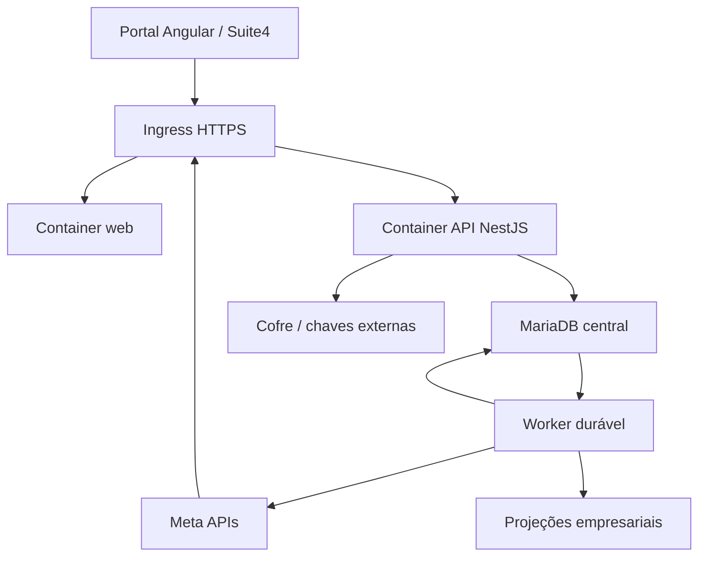

# Arquitetura proposta e decisões

As decisões abaixo são especificações para implementação, apoiadas no cenário atual e sujeitas aos experimentos/gates indicados. Não representam infraestrutura instalada. Angular é preservado; separar API e frontend continua requisito de produto.

## Topologia



Web e API são imagens/containers separados. Worker pode usar a imagem API com command próprio e escalar independentemente. Banco, eventual fila, ingress e telemetria são infraestrutura explícita. Dois containers de aplicação não eliminam essas dependências. Compose de host único é ponto inicial possível, não promessa de alta disponibilidade.

O origin público preferencial é único: `/` serve Angular e `/api` chega à API. Isso reduz complexidade de sessão e CORS. O modo embed ainda exige contrato Suite4 e alternativa top-level quando o navegador bloquear storage/cookies de terceiros.

A experiência completa de conversas continua no Msg4. Este repositório gere conexões, permissões, status e as funções já presentes; eventos/histórico são normalizados e entregues pelos contratos autorizados aos consumidores apropriados.

## Módulos e dependências permitidas

| Módulo | Responsabilidade | Não deve fazer |
|---|---|---|
| Identity/Tenancy | Sessão, membros, papéis, contexto imutável | Confiar em UUID/tenant de payload sem autorização |
| Onboarding | Sessões, state, checkpoints e saga | Acoplar success ao evento de janela ou manter transação durante Graph |
| Meta adapters | Autenticação/descoberta/operação por produto/variante | Usar token root como fallback genérico |
| Credentials | Cofre, ciclo e resolução por contexto | Expor segredo em DTO ou endpoint decrypt público |
| Assets | Relações, grants e estados observados | Fundir conta/número/canal/empresa por ExternalId global |
| Webhooks | Assinatura, inbox, roteamento e normalização | Executar regra pesada antes do ACK durável |
| Jobs | Leases, retries, outbox, dead-letter e replay | Repetir envio ambíguo sem política específica |
| LegacyBridge | Contratos S2S, mapeamento e projeções | Aceitar DB/DSN vindo do browser ou realizar transação distribuída fictícia |
| Audit/Operations | Evidência, retenção e diagnóstico | Guardar payloads e segredos sem necessidade |

Domínio não depende de framework, HTTP da Meta ou tabelas legadas. Aplicação coordena casos de uso. Adaptadores implementam portas de persistência, cofre, transporte, mensageria e consumidores. Controllers validam DTO/autorização e chamam casos de uso; workers invocam os mesmos casos com identidade de serviço controlada.

## ADRs a ratificar e experimentos

| ADR | Decisão inicial | Alternativas e consequência | Prova/gate |
|---|---|---|---|
| 001 · Stack | Angular existente + NestJS | PHP modernizado reduz migração; Next.js exige reescrever UI e não resolve identidade/jobs por si | Compatibilidade/versionamento suportado; build baseline; módulos mínimos |
| 002 · Monorepo | npm workspaces e diretórios apps/packages | Nx/Turborepo somente se escala de tarefas justificar custo | Instalação e scripts determinísticos, imports isolados |
| 003 · Persistência | MariaDB mantido | PostgreSQL não é necessário só para reconstruir; ORM exige driver e migrations reais | Testes MariaDB, DDL/indices, lock, UTC e expand/contract |
| 004 · Jobs | Inbox/outbox duráveis no banco; fila como adaptador | Redis/BullMQ se volume/latência justificar; banco segue fonte da intenção | Crash/lease/redelivery, fairness e benchmark |
| 005 · Edge/sessão | Mesmo origin + cookie opaco | Origens separadas aumentam CORS/CSRF e não resolvem iframe | Browser E2E, trusted proxy e CSRF |
| 006 · Identidade | Ticket curto Suite4 + magic link para membros | OIDC nativo se Suite4 já oferecer pode substituir ticket sob o mesmo contrato | Emissor real, membership, replay e rotação |
| 007 · Credenciais | Cofre servidor com criptografia autenticada | Secret manager/KMS envelope quando disponível; chaves versionadas fora do DB no primeiro adapter | Tamper, restore, rotação e controle de acesso |
| 008 · Isolamento | Tenant obrigatório em todo agregado/query/job/cache | Não reduzir a base legada; validação em policy/repository e constraints | BOLA/IDOR e duas empresas na mesma base |
| 009 · Meta variants | Quatro fluxos, estratégias próprias | Instagram via Facebook preserva baseline; Instagram Login direto exige ADR específico | Matriz primária e sandbox por produto |
| 010 · Distribuição | Operações internas como relay; projeção sem segredo por padrão | Exportação temporária restrita apenas com exceção documentada e retirada | Testes consumidores e zero fallback global |
| 011 · Migração | Fatias com flags, um escritor por função | Reescrita big-bang aumenta corte/rollback simultâneos | Shadow-read, lote, canário e rollback por comportamento |
| 012 · Releases | Duas imagens, digests imutáveis e manifest | Rebuild por ambiente não preserva homologação | Proveniência, SBOM, smoke e promoção por digest |

Cada ADR inclui contexto, opções, decisão, riscos, consequência operacional, experimentos e condição de revisão. Não deixar ORM/fila/provedor de e-mail como escolha implícita do primeiro desenvolvedor.

## Organização alvo

```text
apps/web/                  Angular: sessão, catálogo, onboarding, conexões e funções atuais
apps/api/src/              Módulos NestJS, domínio, casos de uso e adaptadores
packages/contracts/        OpenAPI, schemas públicos e clientes gerados
database/migrations/       Migrações e ledger; sem synchronize em produção
specs/                     Regras, cenários, contratos e evidência por feature
docs/adr/                  Decisões versionadas
docs/runbooks/             Deploy, restore, reauth, retries, incidentes e migração
infra/docker/              Dockerfiles web/api e config de servidor estático
infra/compose*.yaml        Ambientes e dependências explícitas
.github/workflows/         CI, release e deploy conforme gates confirmados
AGENTS.md                  Índice de contexto e regras de trabalho
```

Nenhuma reorganização ocorre no PR de planejamento. Os caminhos acima são alvo da M2. Referências à baseline permanecem por SHA para evitar confundir diretórios futuros com código já existente.

## Estratégia de versões

Angular 21 estava em LTS na consulta de 28/10/2026 segundo [Angular releases](https://angular.dev/reference/releases). Não há necessidade de migrar imediatamente para a versão mais nova para resolver os problemas. Antes de implementar, selecionar patches/Node/TypeScript compatíveis em [Version compatibility](https://angular.dev/reference/versions) e registrar lockfile/base image. NestJS e bibliotecas de auth também exigem versão suportada verificada; a proposta não presume API disponível em uma versão antiga.

Versão da Graph API e versão do Embedded Signup são configurações diferentes e devem ser tratadas separadamente por modalidade. Não copiar `v24.0` do PHP nem uma versão citada no chat sem confirmação na matriz M1.03.

## Slice de implementação inicial

Depois da descoberta, o primeiro slice técnico deve atravessar autenticação de teste → tenant → API → estado de conexão sintético → contrato Angular → CI/imagem. A integração externa entra após cofre/state/worker seguros. O slice não autoriza aceitar ticket falso/UUID em produção: adapters fake são exclusivos de teste e a configuração de produção falha se eles estiverem habilitados.

Escala horizontal exige sessão/replay/leases compartilhados, caches corretamente particionados e limite de concorrência por ativo/app. Estado em memória de uma réplica não pode ser fonte de OAuth, consumo de ticket ou processamento de eventos.
