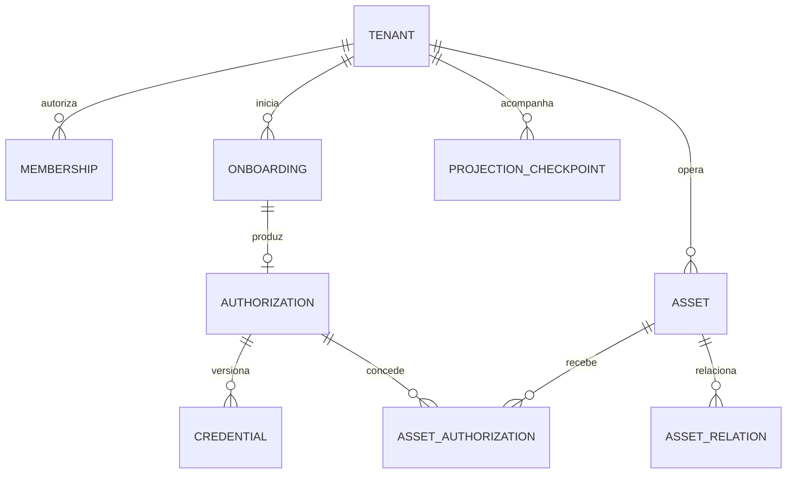

# Domínio, dados, credenciais e projeções

O modelo distingue cinco conceitos: empresa autorizada, processo de conexão, autorização Meta, credencial e ativo. Um token pode conceder acesso a diversos ativos; um ativo pode ter autorizações sucessivas ou concorrentes. O sistema não cria a regra fictícia de um token exclusivo por número.

## Invariantes

1. Toda leitura/alteração de negócio exige contexto de tenant autenticado. `IdDatabase` sozinho não representa uma empresa quando há várias `IdCompany` na mesma base.
2. Ativo externo não é chave global de autorização. App, ambiente, produto, tipo e tenant integram o contexto.
3. IDs externos são strings. Conversão para número JavaScript pode perder precisão.
4. Credencial deve comprovar concessão para a operação e ativo/ancestral verificado. Escopo solicitado não equivale a grant concedido.
5. Nenhum token Meta permanente é devolvido ao navegador. API pública usa DTOs específicos, separados de entidades de persistência.
6. Revogação é monotônica até haver nova autorização comprovada. Snapshot, importação ou evento antigo não reativa segredo revogado.
7. Conexão, credencial, ativo, subscription, histórico e projeção têm estados independentes.
8. Commit central e publicação de intenção outbox são atômicos localmente. Efeito Meta e banco empresarial são operações separadas com checkpoints.

## Relações essenciais

O desenho resume relações. Membership também referencia Principal; autorização/ativo/credencial possuem tenant e appConfig. Um onboarding pode terminar sem autorização, ou produzir vários ativos sob a mesma autorização. Reconexões mantêm histórico e não duplicam segredo sem necessidade.

## Dicionário proposto

Tipos de referência: IDs internos opacos em string (UUID com tipo MariaDB adequado e consistente); `DATETIME(6)` em UTC; enums validados pela aplicação/constraints compatíveis; campos externos `VARCHAR` com tamanho validado pelo contrato; JSON com schema/version explícito. Escolha de ORM não pode mudar essas semânticas.

| Entidade | Campos centrais | Constraints/índices e observações |
|---|---|---|
| Tenant | id, display_name, status, created_at, version | Mapeamento único para origem empresarial legado conforme contrato |
| LegacyTenantMap | tenant_id, legacy_database_id, legacy_company_id, environment | UNIQUE de origem completa; DSN não vem do cliente |
| Principal | id, kind USER/SERVICE, issuer, subject, status | UNIQUE issuer+subject; serviço e pessoa têm permissões distintas |
| Membership | tenant_id, principal_id, roles, status, version | UNIQUE tenant+principal; revogação observada em sessão/jobs |
| PortalSession | id, secret_hash, principal_id, active_tenant_id, context_ref_hash, context_version, issued_at, idle_at, expires_at, revoked_at | Secret hash único; contexto opaco rotacionado na troca de tenant; cookie e membership continuam obrigatórios |
| ConsumedTicket | issuer, jti_hash, consumed_at, expires_at, exchange_binding | UNIQUE issuer+jti_hash e consumo atômico entre réplicas |
| MagicLink | token_hash, principal_ref, expires_at, consumed_at, attempts | Não informa e-mail existente; hash, TTL e propósito limitados |
| MetaAppConfig | id, provider_app_id, environment, flow_variant, auth_variant, graph_version, signup_version, secret_ref, public_config, capabilities_version | Config servidor; segredos por referência; alterações auditadas |
| OnboardingSession | id, tenant_id, principal_id, portal_session_id, flow_variant, app_config_id, state_hash, status, expires_at, version, correlation_id | UNIQUE state_hash; índice tenant/status/expiry; code protegido e efêmero |
| OnboardingStep | tenant_id, onboarding_id, step, status, attempt, started_at, finished_at, safe_error, evidence_ref | UNIQUE onboarding+step+attempt; sem token/raw code em evidência |
| MetaAuthorization | id, tenant_id, app_config_id, flow/auth_variant, provider_subject_ref, granted_scopes, status, issued_at, revoked_at, source_onboarding_id, version | Grant não é confundido com scopes pedidos; reauth guarda origem/histórico |
| MetaCredential | id, tenant_id, authorization_id, family, ciphertext, nonce, auth_tag, key_version, metadata, expires_at, data_access_expires_at, health, last_checked_at, version | Índices tenant/auth/health; segredo não serializável; validade observada |
| MetaAsset | id, tenant_id, app_config_id, provider, kind, external_id, display metadata, normalized/raw state, verified_at, version | UNIQUE tenant+app+ambiente+provider+kind+external_id; raw state com allowlist/retensão |
| AssetRelation | tenant_id, parent_id, child_id, relation_kind, verified_at, source_version | Relações servidor-verificadas; não inferidas só de evento do browser |
| AssetAuthorization | tenant_id, authorization_id, asset_id, operations/capabilities, verification_source, verified_at, revoked_at | UNIQUE tenant+authorization+asset; FKs compostas impedem cross-tenant |
| Connection | id, tenant_id, flow_variant, source_onboarding_id, selected_asset_id, status, version | Representa experiência/vínculo operacional, não propriedade de um token |
| AutomationConfig | tenant_id, asset_id, version, private_welcome, public_reply, private_reply, updated_by | Campos por canal; persistir explicitamente herança/default quando existir |
| SubscriptionTarget | id, app_config_id, provider, target_kind, target_external_id, observed_fields, observed_state, last_checked_at, version | Estado físico do app+alvo; UNIQUE app+ambiente+provider+alvo; nunca listado sem binding autorizado |
| SubscriptionBinding | tenant_id, connection_id, asset_id, target_id, desired_fields, authorization_ref, status | Necessidade por conexão; consulta por tenant; coordenador calcula dependências totais antes de remover subscription |
| InboxEvent | id, app_config_id, event_key, schema_version, raw_ref, received_at, signature_verified, route_state | Payload bruto protegido e TTL; dedupe por item/identidade sem perder atualizações de status |
| RoutedEvent | tenant_id, inbox_id, item_key, asset_id, status, processing_version | Uma entrega contém vários itens/tenants; isolamento por item |
| OutboxEvent | id, tenant_id, aggregate_id, aggregate_version, schema_version, event_type, payload, created_at, delivery_state | Transação local com mudança central; replay seguro e retenção |
| SyncJob | id, tenant_id, type, payload_version, idempotency_key, attempt, next_run_at, lease_owner, lease_expires_at, status, safe_error | Claim atômico; lease/heartbeat/timeout; lane e quotas |
| Operation | id, tenant_id, asset_id, type, request_hash, idempotency_key, outcome, provider_result_ref | PENDING/SUCCEEDED/FAILED/UNKNOWN; timeout externo não vira sucesso/falha inventado |
| ProjectionCheckpoint | tenant_id, destination_ref, aggregate_id, source_version, projection_schema_version, applied_at, last_error | Destino por catálogo; checkpoint/tombstone protege contra atraso |
| AuditEvent | tenant_id, actor, action, target_ref, correlation_id, safe_diff, created_at, retention_class | Sem segredo; acesso restrito e expurgo definido |

Todas as FKs entre agregados empresariais devem incluir `tenant_id`. Mesmo que `id` seja globalmente único, manter chave candidata `(tenant_id,id)` permite a FK composta provar que vínculo não cruza empresas. App/ambiente incompatíveis também são recusados em invariantes e constraints possíveis. Não aceitar update que altere autoria de um ativo só porque um UNIQUE global disparou.

### Compartilhamento de alvo e roteamento

Um alvo de subscription WhatsApp pode cobrir vários números. Quatro números não exigem quatro inscrições físicas independentes. A necessidade por conexão fica em `SubscriptionBinding`; o coordenador serializa mudanças por `app+ambiente+alvo`, consulta todas as dependências autorizadas e impede que desconectar um número derrube os demais.

Conta ancestral e recurso que recebe mensagem não são a mesma exclusividade. O roteamento de PHONE_NUMBER/PAGE/INSTAGRAM_ACCOUNT deve ter reivindicação verificada inequívoca por contexto de app/ambiente. Se houver reivindicação conflitante entre tenants, quarentenar o evento/vínculo e exigir prova/resolução. Não transmitir a todas as empresas que possuem o mesmo external ID. Um ancestral compartilhado pode precisar de coordenação física sem dar acesso aos dados dos demais tenants; o portal só enxerga seus bindings.

## Estados

| Dimensão | Estados propostos | Regra de transição |
|---|---|---|
| Onboarding | CREATED, AWAITING_PROVIDER, CODE_RECEIVED, EXCHANGING, ASSETS_VERIFIED, PROVISIONING, READY, PARTIAL, CANCELLED, EXPIRED, FAILED | Checkpoint/version atômicos; retry de etapa, não replay cego de todo fluxo |
| Credential | VALID, EXPIRING, EXPIRED, REVOKED, UNKNOWN, ACTION_REQUIRED | Evidência provider e prazo conhecidos; rede indisponível não prova revogação |
| Asset | Estado normalizado e raw permitidos por kind | Campos/version/source/freshness próprios de cada produto |
| Subscription | DESIRED, APPLYING, VERIFIED, RETRY_PENDING, ACTION_REQUIRED, REMOVAL_PENDING | Read/receipt evidence quando suportada; sem sucesso fictício |
| Histórico Coexistence | NOT_REQUESTED, CONSENT_PENDING, QUEUED, SYNCING, PARTIAL, COMPLETE, DECLINED, UNAVAILABLE, FAILED | Janelas e efeitos definidos pela versão Meta confirmada |
| Projection | PENDING, APPLIED, RETRY_PENDING, DEAD_LETTER | Versionado por agregado/destino; eventos antigos não sobrescrevem novos |
| Operação externa | PENDING, RUNNING, SUCCEEDED, FAILED, UNKNOWN | UNKNOWN exige reconciliação/política específica; reenvio pode duplicar |

READY deve ser definido por modalidade/capability. Exemplo: ter token salvo não basta se não há ativo verificado ou inscrição obrigatória. Histórico opcional recusado não deve ser confundido com falha de autorização, salvo exigência Meta comprovada.

## Resolução de credenciais

Entrada do serviço interno: `tenantId`, `appConfigId`, `environment`, `provider`, `assetId`, `operation`.

1. Autorizar caller e localizar ativo dentro do contexto permitido.
2. Resolver alvo técnico da operação: número para mensagem, conta para template, Page/IG conforme variante, alvo de subscription confirmado.
3. Carregar grants ativos que cobrem o ativo/alvo e a operação; herança de ancestral só existe com relacionamento/grant verificado.
4. Selecionar família de token adequada à variante, ambiente/app e permissões, rejeitando revogados/expirados.
5. Aplicar preferência determinística e política de saúde quando prazo for desconhecido; não usar token root como alternativa.
6. Obter segredo no processo servidor pelo cofre e executar operação tipada; registrar handle/versão/razão sem valor.
7. Invalidar caches por revisão de autorização, token version e revogação; jobs atrasados revalidam elegibilidade antes de efeito externo.

Exemplo obrigatório de teste: quatro números, dois alvos ancestrais, três concessões e uma reautorização parcial. Envio N1 não pode usar um token só porque foi o último salvo; template da conta de N3 deve escolher grant correspondente. Revogar uma autorização afeta seus grants e pode preservar uma alternativa legítima já comprovada.

## Cofre e ciclo de token

Implementação usa criptografia autenticada consolidada, nonce único, key version e AAD para contexto. Chaves ficam fora do DB/imagem/Git; falha de acesso bloqueia operação com erro seguro. Rotação suporta leitura de versões antigas, lotes/checkpoints e recuperação de backup. Credenciais permanentes não são “hasháveis” para uso futuro; precisam de criptografia recuperável. Hash é adequado a segredos de sessão/link que só exigem comparação.

Metadata registra tipo/família, emissor, app, scopes, emissão, datas retornadas e última inspeção. `expires_at=NULL` significa ausência de prazo conhecido; não significa token invulnerável a revogação. Troca/refresh depende da família; Business Integration token, user token, Page token e variante Instagram não recebem a mesma receita de 60 dias.

## Migração e projeção

Fonte central passa a ser dona de integrações/credenciais após cutover da coorte. Mapeamento de cada campo legado registra direção e escritor por fase. Importação é dry-run primeiro, com contagens/órfãos/duplicações e quarentena; token root sem grant não vira concessão de cliente por cópia.

Outbox publica metadata/referências versionadas. O projetor usa catálogo interno do banco/empresa, transação local de destino, checkpoint e tombstones. Uma falha após commit do destino e antes do ACK é tolerada pelo upsert/version check na reentrega. Central não desfaz commit porque uma empresa está offline.

Segredos não são replicados por padrão. Msg4 opera pelo relay autorizado. Uma exceção para legado que ainda precise do token local exige contexto, criptografia, rotação, auditoria, prazo e plano de retirada; não autoriza endpoint genérico de exportação.
