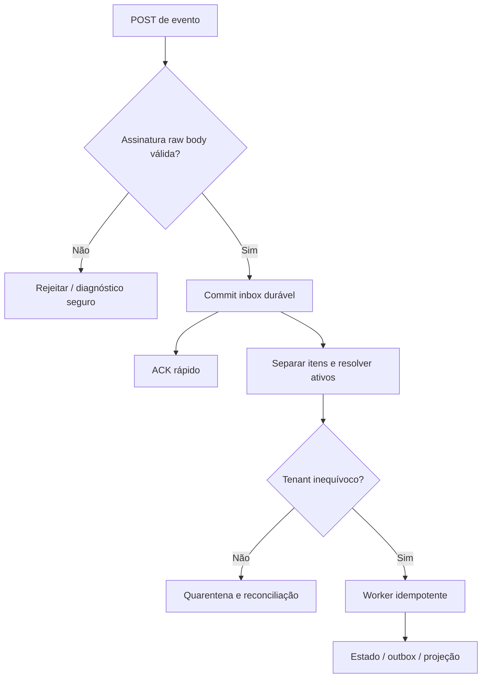

# Quatro fluxos Meta, inscrições e processamento de eventos

## Evidência e configuração

O usuário relatou sucesso de um número Coexistence pelo builder: conta/número, QR, WABA/identificadores e código para troca. Isso é uma prova manual útil de um cenário, não certificação do SDK integrado, quatro fluxos, múltiplas empresas ou operação contínua.

Na consulta de planejamento, páginas principais de `developers.facebook.com` retornaram HTTP 429. Seus detalhes não foram apresentados como confirmados. A [coleção oficial WhatsApp da Meta no Postman](https://www.postman.com/meta/whatsapp-business-platform/documentation/wlk6lh4/whatsapp-cloud-api) e a [coleção oficial Instagram](https://www.postman.com/meta/instagram/documentation/6yqw8pt/instagram-api) ajudam a preparar contratos, mas não substituem validação da versão/configuração real. Fontes secundárias não foram usadas para fixar prazos/limites críticos de Coexistence.

| Material primário | Uso previsto | Situação nesta análise |
|---|---|---|
| [Embedded Signup](https://developers.facebook.com/docs/whatsapp/embedded-signup/) | Fluxo, versão, troca e ativos | Página principal 429; gate M1.03 |
| [Business App onboarding](https://developers.facebook.com/docs/whatsapp/embedded-signup/custom-flows/onboarding-business-app-users/) | Coexistence, histórico, estado, echoes e desligamento | Página principal 429; validar por Sandbox/doc atual |
| [Instagram com Facebook Login](https://developers.facebook.com/docs/instagram-platform/instagram-api-with-facebook-login/) | Variante atual do PHP | Código comprova variante; detalhes atuais da doc pendentes |
| [Instagram com Instagram Login](https://developers.facebook.com/docs/instagram-platform/instagram-api-with-instagram-login/) | Alternativa sob ADR, se adotada | Não confundir com a implementação atual |
| [Graph Webhooks](https://developers.facebook.com/docs/graph-api/webhooks/getting-started/) | Configuração/assinatura/eventos | Página principal 429; validar contrato atual |

`graphVersion`, versão do SDK e versão do Embedded Signup são propriedades diferentes do registro servidor. Não copiar de exemplos antigos nem de um número de versão citado anteriormente no chat. Novas nomenclaturas da interface Meta (conta WhatsApp, conta de mensagens, WABA) precisam de mapeamento por ID/relacionamento confirmado; rótulo visual não estabelece equivalência.

## Matriz de adaptadores

| Variante | Bootstrap/autorização | Ativos e credenciais | Provisionamento próprio |
|---|---|---|---|
| WHATSAPP_CLOUD | Embedded Signup/config validada, número exclusivo | Conta(s), PHONE_NUMBER e autorização verificados; família de token conforme config | Registro/PIN somente se exigido por estado/documentação; subscription e capacidade |
| WHATSAPP_COEXISTENCE | Business App onboarding com QR/consentimento e captura correlacionada | Número ativo no app, conta(s) e grants; Business Integration token quando comprovado | Sem register convencional; subscriptions, estado/echo/histórico conforme capacidade |
| FACEBOOK | Facebook Login for Business independente | PAGE e credenciais apropriadas por Page/grant | Descoberta paginada, tarefas/permissões e campos de subscription suportados |
| INSTAGRAM | authVariant explicitamente escolhida | INSTAGRAM_ACCOUNT e vínculo Page quando exigido; token family própria da variante | Permissões/refresh/subscription por variante; mensagens/comentários conforme review |

Instagram via Facebook é o ponto de partida observado. Instagram Login direto não é obrigatório só para haver card separado; pode ser escolhido após avaliar permissões, migração e integração. Se habilitar as duas variantes, elas compartilham contrato de produto e mantêm adaptadores/credenciais distintos.

## Orquestração comum

1. Autorizar pessoa/empresa e criar OnboardingSession com flow/config e prazo. Gerar state opaco e armazenar hash.
2. Entregar ao browser somente bootstrap público. Consentimento/QR ocorrem na Meta; browser não recebe app secret ou token permanente.
3. Correlacionar callback/código/evento com sessão própria, validando origem/source/schema onde aplicável. Cancelamento é resultado explícito, não gatilho de login recursivo.
4. Trocar código no servidor com estratégia da família, persistindo credencial criptografada e evidência segura. Código de uso único não é refresh token genérico.
5. Descobrir e verificar assets/grants via API autorizada. IDs de postMessage são pistas; não prova de ownership/permissão.
6. Persistir ativos/relações/seleção e outbox em transações locais curtas.
7. Provisionar modalidade e reconciliar subscriptions; iniciar sincronizações exigidas com checkpoints.
8. Avaliar prontidão e retornar READY, PARTIAL ou ACTION_REQUIRED, com passos/evidências. Projetar metadata para bancos empresariais de forma eventual.

### Checkpoints e resultados ambíguos

| Etapa | Dado persistido | Falha/retomada |
|---|---|---|
| Sessão | tenant/ator/config/state hash/status | Expira/cancela sem apagar conexões anteriores |
| Troca de código | tentativa e segredo criptografado quando recebido | Timeout ambíguo não dispara troca em loop; pode exigir novo onboarding |
| Descoberta | assets/grants e fonte de verificação | Paginação/checkpoint; zero ativos é estado informativo, não sucesso total |
| Provisionamento | intenção, outcome e estado observado | Retry só de etapa segura; operação destrutiva não serve de compensação automática |
| Subscription | desired/observed/bindings | Falha mantém PARTIAL e reconcile com budget |
| Sync | stream/cursor/prazo/consentimento | Retomar lotes sem duplicar; estados recusado/indisponível distintos |
| Projeção | outbox/version/checkpoint | Empresa offline acumula backlog sem desfazer commit central |

Uma transação DB não abrange a Meta. Não manter SQL transaction enquanto espera chamadas Graph, QR ou histórico. Uma saga registra efeito e permite reparar inconsistência observada, sem prometer transação distribuída.

## WhatsApp exclusivo

O adaptador usa configuração e jornada de número exclusivo. Descobre as contas e números autorizados com paginação, verifica vínculo e seleciona recursos desejados. Só chama registro convencional/PIN quando estado atual e documentação exigirem; números já provisionados não recebem registro repetido. Não excluir automaticamente WhatsApp Business ou ativos para resolver elegibilidade.

O token de operação deve cobrir número/conta e permissão necessária. Template resolve conta proprietária; mensagem resolve número e grant. Nome aprovado, billing, limites e readiness têm fontes/status próprios; nem todo campo visível no Manager estará disponível por API.

O caminho é aceito com autorização, assets, credencial e subscription verificados, teste de mensagem consentido em Sandbox e recuperação de estados parciais. O sucesso em número do próprio provedor não substitui teste em portfolio cliente separado.

## Coexistence

### Browser

Cada número cria uma OnboardingSession. O adaptador usa configuração/featureType/version comprovados para Business App onboarding e mantém listeners limitados ao ciclo de vida da sessão. Código e evento de sessão podem chegar em ordem diferente; armazenar correlação por sessão, não em um `pendingProduct` único que mistura abas.

Eventos de janela exigem schema/type/event, limites e origem exata documentada. `event.source` deve ser verificado quando o SDK expõe vínculo útil e comprovado. Não aceitar um sufixo genérico de domínio ou payload que declare tenant. Mesmo evento esperado não comprova os grants no backend.

O limite implementado para M4.05 está descrito em [Coexistence browser onboarding](specs/coexistence-embedded-signup.md) e [ADR-013](adrs/ADR-013-m4-05-coexistence-browser-correlation.md): a rota separada mantém o adapter desativado enquanto versão, `featureType`, schema e semântica origin/source não tiverem evidência oficial revisada. Fixtures locais normalizam apenas a interface interna; não representam mensagem Meta.

Quando o usuário conclui QR, UI informa que está verificando a conexão. FINISH não equivale a READY. Campos opcionais de evento não devem ser exigidos cegamente: IDs faltantes podem ser descobertos pelo backend dentro do escopo autorizado; ambiguidade exige seleção/prova e não “primeiro recurso retornado”.

### Servidor

Trocar código com estratégia de Business Integration quando confirmada pela config; guardar tipo/escopos/datas reais. Verificar conta/número via API e associar grants no tenant de origem. Um token pode cobrir recursos já existentes ou novos; reconexão não apaga configurações anteriores.

**Guarda obrigatória:** o adaptador Coexistence não executa register/deregister/delete convencional de número como parte de onboarding/retry. Erro de parceiro/registro não determina causa por si só e não autoriza excluir conta/portfolio. O caminho de desligamento exige procedimento específico comprovado.

Subscription e sincronização são etapas explícitas. Sincronização de histórico segue consentimento e prazo da versão validada; o planejamento não fixa janela de 24 horas ou outra condição sem prova atual. UI acompanha progresso e ação necessária. Recusa de histórico não é apresentada como falha de token.

### Estado, histórico e echoes

Preparar parsers versionados para famílias de eventos `history`, `smb_app_state_sync`, `smb_message_echoes`, `account_update` conforme disponibilidade confirmada. Não afirmar que todos são obrigatórios ou idênticos em qualquer versão.

Cada stream possui checkpoint por tenant/número, identidade de lote/item e controle de ordem. Guardar consentimento, import time e provider timestamp separadamente. Duplicata de lote não cria outra conversa/mensagem. Echo do app e envio API com identidade equivalente não disparam automação em loop. Status de entrega pode ter várias mudanças para o mesmo message ID; dedupe não pode descartá-las como “mensagem repetida”.

Mídia exige download autenticado/host permitido, limites de tamanho e retenção. Conteúdo histórico não vai para logs de plataforma ou fixtures de teste sem sanitização.

## Facebook

Fluxo independente pede somente permissões necessárias a operações aprovadas. Descoberta percorre Pages e tarefas/permissões reais, com paginação e estratégia adequada; não depender apenas de target IDs de debug_token. Derivar/guardar Page tokens com família e prazo observados, vinculando grants à Page certa.

Zero Pages, tarefa ausente e permissão parcial são resultados úteis. Subscription usa Page/target e campos suportados pela config/documentação. Validar resultado e eventos reais de teste antes de liberar capabilities de mensagem/comentário. Não adicionar Instagram/WhatsApp implicitamente porque o user token os alcança.

## Instagram

O PHP atual entra por Facebook, descobre `instagram_business_account` e usa dados da Page. Novo adaptador precisa completar subscription e ciclo de estado/token, preservando semântica. Variante com Instagram Login, se adotada, muda endpoints, scopes e refresh; não compartilhar a mesma receita nem exigir uma Page artificialmente.

Config registra authVariant e o resolver/transport a consultam. Recursos profissionais autorizados são verificados no servidor. Conta pessoal/inelegível, ausência de vinculação necessária, permissão de comentários/mensagens faltante e App Review incompleto geram ação clara. Não transformar retorno OAuth bem-sucedido em conta operacional sem grant e webhook comprovados.

## Subscriptions

Dois níveis são diferentes: configuração do webhook/campos no aplicativo e inscrição do app no ativo. O reconciler mantém intenção e observação, com locks por alvo físico e necessidade por conexão/tenant. WhatsApp pode ter alvo ancestral cobrindo vários números; Facebook e Instagram dependem de variante/campo.

Antes de remover inscrição, conferir todos os bindings/consumidores autorizados, inclusive quando o alvo cobre números diferentes. Uma desconexão local não deve derrubar as outras. Em 429/timeout/permissão ausente, manter diagnóstico e retry da etapa; um try/catch seguido de auth_success não é aceite.

## Webhook ingress e worker

GET challenge usa verify token, que é segredo diferente de access token. POST valida `X-Hub-Signature-256` sobre bytes originais com app secret correto antes de confiar no payload. Persistência falhou? Não confirmar sucesso e perder evento. ACK não espera resposta de regra de negócio, Graph ou banco empresarial.

Uma entrega pode conter vários entries/changes/tenants: resolver por item, sem um tenant global do envelope. App/ambiente/leaf asset verificados definem rota. Evento desconhecido pode chegar antes de concluir onboarding; guardar/quarentenar e reprocessar quando mapeamento existir. Não aceitar tenant do body.

## Matriz mínima de testes por modalidade

| Cenário | WA exclusivo | Coexistence | Facebook | Instagram |
|---|---|---|---|---|
| Sucesso com grant/ativo/webhook | obrigatório | obrigatório + uso do app | obrigatório Page | obrigatório por variante habilitada |
| Cancel/erro sem code/zero ativos | obrigatório | obrigatório + QR/SDK | obrigatório | obrigatório |
| Replay/state/código de outra sessão | obrigatório | obrigatório + ordem dos eventos | obrigatório | obrigatório |
| Permissão parcial/revogada | obrigatório | obrigatório | obrigatório por Page | obrigatório por conta/variante |
| Timeout/429/crash após efeito | obrigatório | obrigatório por checkpoint | obrigatório | obrigatório |
| Reauth/disconnect seletivo | obrigatório | sem register tradicional | preservar grants válidos | preservar vínculo válido |
| Múltiplos recursos/paginação | números/contas | quatro números/contas | várias Pages | várias contas/Pages quando aplicável |
| Echo/histórico/estado | eventos compatíveis | obrigatório conforme capacidade/consentimento | eventos próprios sem loops | eventos próprios sem loops |

Casos reais só usam recursos autorizados e consentidos. CI usa fixtures/stubs fiéis; evidência de mock e Sandbox deve ser distinta no gate de release.
