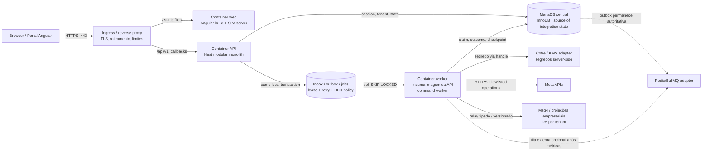

# M1.04 · Topologia e responsabilidades

Status: proposta executável para descoberta/implementação futura, não infraestrutura implantada. Issue: [#13](https://github.com/costaapps/ca_meta_app/issues/13). Data: 2026-10-28.

## Diagrama de containers

O mesmo pacote de aplicação Nest pode ser executado como API ou worker; são containers/processos e escala independentes. MariaDB é a fronteira de persistência durável da intenção. Redis/BullMQ é alternativa, não requisito mínimo nem fonte de verdade. A tabela outbox é inserida na mesma transação InnoDB que o estado central; entrega pode ser repetida após expiry/crash. Um efeito Meta pode ficar desconhecido se resposta/ACK se perder: idempotency local não torna o provider exactly-once.

## Responsabilidades por ambiente

| Recurso | Dev local | Staging | Produção |
|---|---|---|---|
| Web | imagem/servidor local; config pública sintética; sem token | digest de release e domínio/callback exclusivos; dados sintéticos ou autorizados | digest promovido; domínio/config aprovado e TLS verificado |
| Ingress | Compose host-local; sem porta DB exposta | TLS, allowlist de proxy confiável, rate/body limits ensaiados | TLS/DNS/WAF/proxy e alertas sob owner operacional confirmado |
| API | Nest local/Compose e tenant fixtures | imagem API; migração é job separado; health/readiness | API horizontal por CPU/requests/latência medidos; sessão e state compartilhados |
| Worker | command worker; lease curta apenas no harness | mesmo digest API, command distinto; drain/lease; fila/inbox sintéticas | réplicas separadas por backlog/fairness/quotas; SIGTERM e idempotência; escala após SLO/carga confirmados |
| DB central/outbox | MariaDB 11.8 descartável, namespace isolado | schema N/N-1 e backup/restore praticados | backup, HA, disk/I/O, RPO/RTO, owners e região ainda precisam decisão/evidência |
| Fila opcional | ausente na opção inicial; Redis para experimento futuro | mesma configuração isolada do ambiente, retenção definida | só após decisão por métricas; outbox continua recuperável e rebuild testado |
| Vault/chaves | marcador/senha ephemeral; nunca Meta real | namespace e key IDs separados, valores não em CI PR | serviço/CMK/IAM/rotação/restore ratificados; valores nunca na imagem/Git |
| Meta/callbacks | mocks e fixtures; sem chamadas reais | app e ativos de teste com grants confirmados antes do cenário | config por app/env/modalidade; rollout só após gates do cenário |
| Projeção empresarial | fake sink/DB sintético | espelho ou projeto isolado com tenant mapeado | tenant DB selecionado somente por catálogo servidor, limite e owner confirmados |

Os nomes de domínio, contas, proxy, KMS, região, IDs de app Meta, DB credentials, quotas, SLOs e grants reais permanecem **Not confirmed**. Não preencher placeholders por inferência.

## Rede, origem e escala

Publicar apenas HTTPS no ingress. `MariaDB` e eventual `Redis` ficam na rede interna, sem porta pública. O browser chama `/api/v1` no mesmo origin do Angular. `Forwarded`/`X-Forwarded-*` só são interpretados a partir do proxy confiável. Configuracões e callbacks são segregados por ambiente. API e worker leem o mesmo digest para reprodutibilidade, mas deployment/HPA/CPU/concurrency são independentes. Em host único há SPOF; HA/Kubernetes/service mesh não são requisito do primeiro release sem SLO demonstrado.

## Escala do worker e shutdown

Cada job carrega tenant, chave de operação, versão, status e lease; cada claim valida membership/grant antes de efeito Meta. Pool/concorrência são limitados por tenant, ativo e app. Workers claim com transação e `FOR UPDATE SKIP LOCKED`, registram lease curto e liberam; manutenção/fairness e índices devem evoluir com carga. SIGTERM bloqueia novos claims, drena a unidade reclamada dentro de um grace period; execução interrompida deixa lease expirar e permite redelivery idempotente. Saída ambígua de provider vira UNKNOWN/reconciliação.

## Alternativas e custo inicial

- Não requer SSR/SEO nem renderização Angular acoplada à API.
- Sem Redis/BullMQ inicialmente: elimina serviço/backup/monitoramento adicionais antes de demonstrar necessidade de throughput; custo é polling/banco, a validar com carga.
- Não requer segundo banco relacional sem requisito de migração; PostgreSQL introduziria cutover enquanto DBs empresariais continuam coexistindo.
- Não requer Kubernetes/service mesh na primeira implantação: mais operação/observabilidade do que uma prova local necessita; antes do deploy, M6 deve verificar se SLA/topologia autorizados pedem alta disponibilidade.
- Banco empresarial não participa de transação distribuída com central; projeção tem checkpoint e outbox, retries e compensação.

## Prova e limites

PoC executada em container com as versões/digests descritos no [harness](../../tools/m1-04/README.md). É prova isolada de driver/migration/JSON/index/transaction/lease/concurrency/failure/drain. Não mede latência/capacidade nem configura domínio/TLS, Suite4 real, KMS, grants Meta ou failover de produção.
