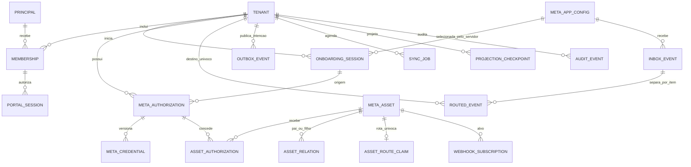

# M1.05 — Modelo de domínio, relações e invariantes

**Issue:** [#14](https://github.com/costaapps/ca_meta_app/issues/14). **Natureza:** contrato de domínio proposto para a M2; não é DDL de produção nem descrição de grants/eligibilidade atuais da Meta. O harness em [`tools/m1-05/`](../../tools/m1-05/README.md) cria schema descartável sintético em MariaDB 11.8 e verifica os limites relacionais documentados.

## Limites e regras

- Cada entidade de negócio tem ID interno opaco e versão otimista. Chaves internas de referência usam `tenant_id` junto com o ID do agregado para que uma FK prove o mesmo tenant.
- ID externo é texto UTF-8 comparado de forma exata; nunca passa por `Number`, `BIGINT` ou normalização numérica. Identidade observada de ativo é tenant + provider + app + environment + kind + external ID. Eventos podem revelar conflito entre tenants; isso leva o item para quarentena, sem fanout ou escolha pelo login mais recente.
- `MetaAppConfig` é configuração controlada pelo servidor (app, ambiente, variante e versões/configuração de capabilities); o cliente não escolhe app, segredo ou ambiente. Pode ser compartilhada como perfil da plataforma; entidades tenant-scoped mantêm sua própria chave composta.
- Uma autorização pode conceder acesso a vários ativos. Um ativo pode manter várias autorizações válidas ou históricas ao longo de reautorização. Credencial pertence a uma autorização e tem versão/família; não existe token global por empresa, app ou número.
- Campos de observação sempre carregam `source`, `observed_at` e versão. Indisponibilidade ou ausência de observação resulta em `UNKNOWN` ou `STALE`, nunca em validade/revogação presumida.
- Instantes são UTC (`DATETIME(6)` no experimento); enumeração e JSON têm versão de schema. Mudanças concorrentes usam `version`/ETag e atualização condicional.
- Nenhum DTO de portal inclui ciphertext, nonce/tag/chave, token, authorization code, payload webhook bruto ou identificador de cofre. `secret_ref` e `raw_ref` são handles internos com acesso restrito.

## ERD proposto

## Dicionário e chaves propostas

`PK` identifica o ID interno; `UQ` denota unicidade; `FK(tenant,id)` significa uma chave estrangeira composta, não apenas um ID global. O harness implementa as entidades listadas com `m105_` e as constraints assinaladas como exercitáveis; nomes/tipos finais dependem da migração revisada da M2.

| Entidade | Identidade e campos essenciais | Integridade e semântica |
|---|---|---|
| `Tenant` | `id`, `status`, `created_at`, `version` | PK; todo agregado de negócio usa `tenant_id`; tenant legado é resolvido server-side. |
| `Principal` | `id`, `kind`, `issuer`, `subject`, `status`, `version` | UQ `(issuer,subject)`; identidades user/service têm políticas distintas. |
| `Membership` | `(tenant_id,principal_id)`, `roles`, `status`, `version` | PK composta; FK tenant e principal; revogação revalidada em sessão e job. |
| `PortalSession` | `id`, `tenant_id`, `principal_id`, `secret_hash`, `context_ref_hash`, `context_version`, `issued_at`, `idle_at`, `expires_at`, `revoked_at`, `version` | FK `(tenant_id,principal_id)` para membership; somente hash do segredo; troca de contexto rotaciona referência. |
| `MetaAppConfig` | `id`, `provider`, `provider_app_id`, `environment`, `flow_variant`, `auth_variant`, `graph_version`, `signup_version`, `secret_ref`, `public_config`, `capabilities_version`, `version` | UQ `(provider,provider_app_id,environment,flow_variant,auth_variant)` e chaves candidatas para app+provider+environment, app+environment e app+flow+auth; segredos são referências backend. Versões Graph e Signup distintas; a configuração de variantes não afirma semântica de grant Meta. |
| `OnboardingSession` | `id`, `tenant_id`, `principal_id`, `app_config_id`, `flow_variant`, `auth_variant`, `state_hash`, `status`, `expires_at`, `correlation_id`, `readiness_policy_version`, `readiness_reasons`, `readiness_evaluated_at`, `version` | FK composta a membership; `state_hash` único; FK `(app_config_id,flow_variant,auth_variant)`; candidato de contexto inclui tenant/id/app/flow/auth; code/state efêmeros fora de log/DTO; readiness guarda policy, avaliação e motivos recuperáveis. |
| `OnboardingStep` | `id`, `tenant_id`, `onboarding_id`, `step_name`, `attempt`, `status`, `safe_error_code`, `retryable`, `started_at`, `finished_at`, `evidence_ref`, `version` | UQ `(tenant,onboarding,step,attempt)`; FK onboarding composta; grava tentativa/checkpoint e erro tipado sem resposta bruta do provider. |
| `MetaAuthorization` | `id`, `tenant_id`, `app_config_id`, `environment`, `source_onboarding_id`, `flow_variant`, `auth_variant`, `provider_subject_ref`, `granted_scopes`, `status`, `issued_at`, `revoked_at`, `version` | FKs compostas garantem que app/ambiente/flow/auth coincidam com onboarding de origem e configuração; UQ `(tenant,id,app,environment)` para relações; scopes concedidos diferem dos pedidos. Reauth cria novo registro. |
| `MetaCredential` | `id`, `tenant_id`, `authorization_id`, `family`, `issuer`, `app_config_id`, `environment`, `ciphertext`, `key_version`, `scopes_snapshot`, `authorization_version`, `expires_at`, `data_access_expires_at`, `health`, `observed_source`, `observed_at`, `version` | FK `(tenant,authorization,app,environment)` e FK `(app,environment)`; guarda snapshot de scopes e versão da autorização de origem; uma nova emissão é nova versão/linha; segredo cifrado somente no servidor. `NULL` expiry é prazo desconhecido, não vitalício. |
| `MetaAsset` | `id`, `tenant_id`, `app_config_id`, `provider`, `environment`, `kind`, `external_id`, `observed_status`, `observed_source`, `observed_at`, `version` | UQ `(tenant,provider,app,environment,kind,external_id)`; chaves candidatas incluem `(tenant,id,app,environment)` e a identidade completa mais tenant/id para FK de rota; FK confere provider/app/environment com configuração; external ID é texto exato. |
| `AssetRouteClaim` | `id`, `provider`, `app_config_id`, `environment`, `kind`, `external_id`, `tenant_id`, `asset_id`, `claimed_at`, `version` | Índice único por `(provider,app,environment,kind,external_id)` reserva rota inequívoca; FK composta para `(provider,app,environment,kind,external_id,tenant,asset_id)` da mesma linha `MetaAsset`. Um claim com tenant/app válido mas kind ou external ID diferente também é rejeitado. |
| `AssetRelation` | `id`, `tenant_id`, `app_config_id`, `environment`, `parent_asset_id`, `child_asset_id`, `relation_kind`, `observed_source`, `observed_at`, `version` | FKs compostas exigem pai e filho do mesmo tenant, app e ambiente; UQ relação direcionada; hierarquia é observada pelo servidor, não inferida do browser. |
| `AssetAuthorization` | `id`, `tenant_id`, `authorization_id`, `asset_id`, `app_config_id`, `environment`, `capabilities`, `status`, `verified_at`, `revoked_at`, `version` | FKs compostas exigem a mesma tupla tenant/app/ambiente tanto na autorização quanto no ativo; UQ `(tenant,authorization,asset)`; revogar uma linha não remove grants de outro ativo ou autorização. |
| `WebhookSubscription` | `id`, `tenant_id`, `app_config_id`, `environment`, `target_asset_id`, `desired_fields`, `state`, `observed_status`, `observed_source`, `observed_at`, `version` | FKs compostas exigem target do mesmo tenant/app/ambiente e app/environment existente; estado desejado e observado separados; compartilhamento físico deve ser coordenado pelas bindings autorizadas. |
| `InboxEvent` | `id`, `app_config_id`, `provider_event_id`, `schema_version`, `received_at`, `signature_state`, `raw_ref`, `route_state`, `version` | UQ `(app_config_id,provider_event_id)` para dedupe de envelope; `raw_ref` protegido e retido por política. |
| `RoutedEvent` | `id`, `inbox_event_id`, `app_config_id`, `item_key`, nullable `tenant_id`/`asset_id`, `route_state`, `processing_version`, `version` | UQ `(inbox_event_id,item_key)`; FK `(inbox_event,app_config)` ao inbox e `(tenant,asset,app_config)` ao ativo quando resolvido. Item ambíguo fica `QUARANTINED` sem tenant/asset atribuído; não é entregue a vários tenants. |
| `OutboxEvent` | `id`, `tenant_id`, `aggregate_id`, nullable `aggregate_asset_id`, `aggregate_version`, `schema_version`, `event_type`, `idempotency_key`, `payload`, `created_at`, `delivery_state`, `attempt`, `version` | Inserido na mesma transação da mudança local; UQ `(tenant,aggregate_id,aggregate_version,event_type)`; replay é ao menos uma vez. Payload é versionado e redigido. |
| `SyncJob` | `id`, `tenant_id`, nullable `onboarding_id`, `type`, `payload_version`, `idempotency_key`, `attempt`, `next_run_at`, `lease_owner`, `lease_expires_at`, `status`, `safe_error`, `version` | UQ `(tenant,type,idempotency_key)`; onboarding retry tem FK composta quando informado; claim/ACK condicionais a lease/token atual; erro persiste código seguro, sem segredo bruto. |
| `ProjectionCheckpoint` | `(tenant_id,destination_ref,aggregate_id)`, `source_version`, `projection_schema_version`, `applied_at`, `tombstone_version`, `status`, `version` | Chave composta; aplicar somente versão estritamente maior; tombstone de revogação ganha de snapshot antigo. |
| `AuditEvent` | `id`, `tenant_id`, `actor_ref`, `action`, `target_ref`, `correlation_id`, `safe_diff`, `created_at`, `retention_class`, `record_version` | FK tenant-scoped; append-only; writer de aplicação aceita somente chaves/valores allowlisted para `safe_diff`, nunca segredo/código/token/payload bruto. JSON schema não redige conteúdo; a escrita SQL direta deve ser restrita ao writer validado. |

### FKs tenant-scoped, queries e conflito de rota

Para toda associação empresarial, a chave candidata `(tenant_id,id)` do pai é referenciada junto com o `tenant_id` do filho. Quando o recurso depende de perfil ou ambiente, a chave composta também inclui esse contexto: `AssetAuthorization` exige tenant/auth/asset/app/ambiente consistentes; credential e subscription conferem app/ambiente, e authorization confere seu onboarding de origem. O harness tenta esses contextos incompatíveis e espera rejeição 1452. A consulta de negócio também inclui `tenant_id` obtido da sessão, não um valor de request. A FK prova consistência de gravação; autorização/query prova leitura.

O mesmo provider/app/environment/kind/external ID associado a mais de um tenant pode representar conflito de ownership ou rota; a unicidade local por tenant preserva a evidência. Um índice global mínimo `AssetRouteClaim`, acessível ao serviço confiável de webhook, mapeia essa identidade para no máximo um `(tenant_id,asset_id)`. Sua FK compara a identidade roteada inteira com a linha de `MetaAsset`; tenant correto com ID externo ou tipo diferente também falha. O harness tenta esse claim incompatível no mesmo tenant. Conflito da identidade real entre dois tenants é rejeitado pela chave única e cria `RoutedEvent.QUARANTINED`, sem escolher tenant, asset ou fanout. Não faz leitura de perfil/grants/payload de outros tenants; resolver exige evidência e operação auditada; nunca usa último login, token recém-salvo ou “primeiro resultado”. Ativos ancestrais compartilháveis para subscription não concedem autorização aos filhos de outro tenant.

### Eventos, tombstones, idempotência e retenção

- Webhook é validado e armazenado uma vez como envelope em `InboxEvent`; itens de lote têm chave por `item_key`. Duplicar envelope/item retorna registro existente e não repete roteamento. Mudanças de status em item preservam identidade/versionamento ao invés de desaparecerem por dedupe do envelope.
- Entrega do outbox tem semântica pelo menos uma vez. Consumidor grava idempotency key e aplica apenas `aggregate_version` maior que o checkpoint. Resultado ambíguo do efeito externo fica `UNKNOWN` e exige reconciliação; não alegar exactly-once.
- Revogação/desconexão cria tombstone com versão monotônica e audit event; não apaga histórico necessário para não-revivência. Evento/snapshot com versão menor ou igual não restaura grant/subscription/projeção. Nova autorização explícita recebe novos IDs/versões.
- `InboxEvent.raw_ref`, diagnóstico de provider, credenciais cifradas e PII de sessão têm acesso, expurgo e retenção mínimos e separados. Duração por classe, legal hold, localização e requisitos de replay serão fixados em M1.09/M2; este contrato não inventa prazo nem expõe dados brutos no audit.
- `AuditEvent` é append-only, versionado e recebe diff por writer de aplicação com allowlist de campos (`before`, `after`, `status`, `policyVersion`, `version`, `reasonCode`) e enums de estado/motivo. A allowlist de estados inclui os documentados para credenciais (como `VALID`, `EXPIRING`, `ACTION_REQUIRED`) e ativos (`INACTIVE`). O harness também valida `actorRef`, `action`, `targetRef` e `retentionClass` contra os valores sintéticos exatos usados pelos seus dois exemplos; isso não define os valores de produção. Ele rejeita chaves como `accessToken` e referências livres. A restrição JSON no banco só valida JSON e não detecta segredos; produção precisa de writer e policy próprios e deve impedir inserção direta por outros writers. Nunca registrar access token, authorization code, app secret, cookie, chave, ciphertext, corpo webhook integral, header sensível ou mensagem do cliente.

## Fixture de quatro números

[`coexistence-scenarios.json`](../../tools/m1-05/fixtures/coexistence-scenarios.json) contém duas topologias de teste. Na topologia de um WABA há quatro onboards iniciais (um por número), cada qual com autorização/credencial separada; reautorizar N3 cria uma quinta autorização/credencial e preserva as outras conexões. Na topologia de dois WABAs, cada autorização cobre o par de números daquele WABA; reautorizar N13 mantém o grant anterior até revogação explícita. Assim, a fixture demonstra onboarding sequencial e autorização que cobre vários ativos sem estabelecer que a Meta emita tais grants nesse fluxo real. Todas as strings começam por `synthetic:`; nenhuma afirma disponibilidade ou elegibilidade real de Coexistence.
