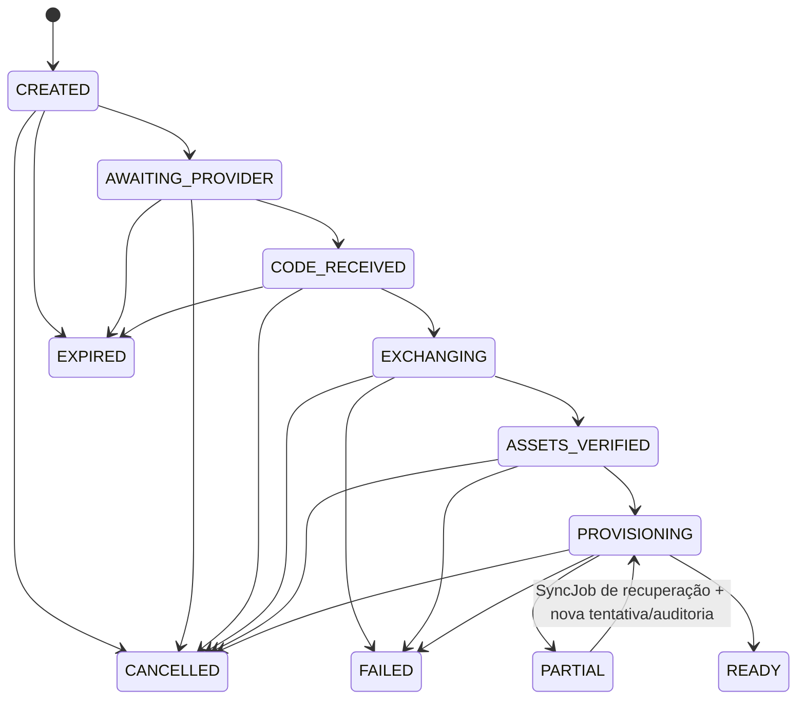

# M1.05 — Estados independentes, readiness e cenários

Contrato proposto. Estados/escopos da Meta que não foram observados permanecem **Not confirmed**. A fixture e o banco em [`tools/m1-05/`](../../tools/m1-05/README.md) são completamente sintéticos. Este documento não muda o OpenAPI/event schema proposto, reservado à M1.07.

## Estado é por agregado

| Agregado | Dimensão de estado | Valores propostos | Evidência e atualização |
|---|---|---|---|
| OnboardingSession | progresso da saga | `CREATED`, `AWAITING_PROVIDER`, `CODE_RECEIVED`, `EXCHANGING`, `ASSETS_VERIFIED`, `PROVISIONING`, `READY`, `PARTIAL`, `CANCELLED`, `EXPIRED`, `FAILED` | Cada transição guarda versão, timestamp UTC, ator/serviço, correlation ID e checkpoint. Retry retoma uma etapa idempotente; não reinicia cegamente efeitos externos. |
| OnboardingStep | tentativa de etapa | `PENDING`, `RUNNING`, `SUCCEEDED`, `RETRY_PENDING`, `FAILED`, `UNKNOWN`, `SKIPPED` | Uma nova tentativa ganha índice; erro é tipado/redigido. `UNKNOWN` exige reconciliação antes de repetir efeito ambíguo. |
| MetaAuthorization | grant | `ACTIVE`, `REAUTH_REQUIRED`, `REVOKED`, `UNKNOWN` | Atualizada por resposta ou observação identificada; início de reauth não revoga o grant anterior. |
| MetaCredential | saúde de cada credencial | `VALID`, `EXPIRING`, `EXPIRED`, `REVOKED`, `UNKNOWN`, `ACTION_REQUIRED` | `expires_at`, `observed_source`, `observed_at`, issuer/app/family e key version próprios da credencial. Rede indisponível/idade excessiva resulta em `UNKNOWN`/stale, não `REVOKED`. |
| MetaAsset / AssetAuthorization | estado do ativo e vínculo de grant | status normalizado por kind (`ACTIVE`, `INACTIVE`, `UNKNOWN`, `STALE`) separado do vínculo (`VERIFIED`, `REVOKED`, `UNKNOWN`) | Snapshot tem fonte e frescor. Revoke de um vínculo não altera o status do ativo ou grants de outros ativos. |
| WebhookSubscription | desejado vs observado | desired (`ON`, `OFF`); observed (`VERIFIED`, `MISSING`, `UNKNOWN`, `STALE`); job (`PENDING`, `APPLYING`, `RETRY_PENDING`, `ACTION_REQUIRED`) | Reconciliador registra request/receipt/readback suportado pela variante. Sem confirmação, mantém unknown. Um target ancestral pode ter bindings independentes. |
| RoutedEvent | roteamento por item | `PENDING`, `ROUTED`, `QUARANTINED`, `REJECTED`, `PROCESSED` | Identidade `(inbox_event_id,item_key)`; o lote pode rotear a tenants diferentes item a item. Ambiguidade mantém tenant/asset nulos. |
| OutboxEvent / SyncJob | entrega e trabalho | `PENDING`, `RUNNING`, `RETRY_PENDING`, `SUCCEEDED`, `FAILED`, `UNKNOWN`, `DEAD_LETTER` | Tentativas/idempotency key/lease e safe error versionados; lease vencida não pode ser confirmada pelo dono antigo. |
| ProjectionCheckpoint | réplica derivada | `CURRENT`, `PENDING`, `STALE`, `TOMBSTONED`, `FAILED` | `source_version` e `tombstone_version` avançam monotonicamente por tenant/destino/agregado. |

Estados de onboarding, token, vínculo de ativo, subscription, webhook, job e projeção não são cópias uns dos outros. Um onboarding pode ser `READY` enquanto subscription opcional fica desconhecida somente se a policy declarada daquela modalidade não a requerer e a capacidade opcional não tiver sido pedida. O portal mostra a observação/timestamp stale e ações seguras; “READY” não esconde observações desconhecidas.

## Transições de onboarding

Para a jornada normal, avanço é estritamente adjacente no fluxo acima; mudança condicional usa `WHERE id=? AND tenant_id=? AND status=? AND version=?`, acrescenta audit e incrementa version na mesma transação da outbox. `PARTIAL` fica consultável e somente volta a `PROVISIONING` por `SyncJob` de recuperação do mesmo tenant/onboarding, com nova tentativa de step, policy/evidence reavaliada, idempotency key e audit. Repetir diretamente `PARTIAL→READY`, voltar para etapas do provider ou reabrir `READY`/`CANCELLED`/`EXPIRED`/`FAILED` é recusado. Nova autorização ainda requer outro `OnboardingSession`; retry de provisionamento não reautoriza silenciosamente. Tentativa repetida com mesma idempotency key/payload retorna registro/resultado anterior. `EXPIRED` exige relógio UTC do servidor e vencimento da própria sessão; não infere expiração Meta. O código efêmero recebido não é auditado nem devolvido no DTO.

## READY e PARTIAL são derivados de policy versionada

Cada configuração de fluxo publica no backend um `ReadinessPolicy` versionado: capacidades/pré-requisitos **obrigatórios**, opcionais e quais foram pedidos neste onboarding. O [harness](../../tools/m1-05/src/readiness.js) fixa policy de teste explícita. A policy real de cada flow Meta, endpoints, grants, elegibilidade e pré-requisitos permanecem **Not confirmed** até evidência autorizada da M1.03/M2.

O seletor da policy usa a tupla configurada no servidor `(provider_app_id, environment, flow_variant, auth_variant, capabilities_version, readiness_policy_version)`. Não existe um fallback comum que converta “code trocado” em READY. Perfis a materializar por cada combinação do app/configuração:

| Chave do perfil | Política de READY/PARTIAL |
|---|---|
| Facebook Login for Business / variante Facebook | Required capabilities, asset kinds, auth family e subscription alvo: **Not confirmed** por app/ambiente/versão; ausência de prova é `UNKNOWN` e mantém PARTIAL quando requisito. |
| Instagram via Facebook Login | Separada da variante Instagram Login; vínculo Page/conta, capabilities e subscription: **Not confirmed** por app/ambiente/versão. |
| Instagram Login (opcional) | Perfil/auth configuration e credenciais independentes; não herda scopes ou grants da variante Facebook Login; prerequisitos específicos: **Not confirmed**. |
| WhatsApp Cloud API exclusivo | Configuração, WABA/número, operação, subscription e registro: requisitos vêm da capability policy versionada; ainda não afirmados por este modelo. |
| WhatsApp Coexistence | Perfil separado de WhatsApp exclusivo; elegibilidade, consentimento, históricos/echo e operação: **Not confirmed**; não permitir que falta de evidência caia em fluxo de registro convencional. |

Os nomes de variantes identificam perfis separados, não certificam que cada perfil esteja ativo ou habilitado no produto. O harness exercita apenas um perfil sintético Coexistence e exige que sua policy seja input explícito.

| Condição avaliada na policy aplicada | Resultado |
|---|---|
| Todos os requisitos obrigatórios foram verificados; credencial selecionada é elegível para a operação, app/ambiente/flow conferem, e não há conflito de rota ou erro obrigatório | `READY` |
| Qualquer requisito obrigatório está `UNKNOWN`, `STALE`, pendente ou ausente | `PARTIAL`, com `nextAction` e motivo recuperável; nunca supor sucesso |
| Capacidade opcional foi explicitamente pedida, mas está `UNKNOWN`, `STALE`, não concedida ou falhou provisoriamente | `PARTIAL`, registrar falta opcional sem descartar as capacidades válidas |
| Capacidade opcional não foi pedida e todos os requisitos obrigatórios foram verificados | Não bloqueia `READY`; observação continua visível separadamente |
| Requisito obrigatório observado `REVOKED`/não permitido ou conflito que precisa intervenção | `PARTIAL` com ação `REAUTH_REQUIRED`/`RESOLVE_CONFLICT`; falha definitiva de fluxo fica `FAILED` com código seguro |

Uma troca de code por token não é suficiente para `READY`. Uma credencial de mesma empresa/app mas sem `AssetAuthorization` verificado para ativo/capability não satisfaz a policy. Cada avaliação guarda `policy_version`, evidence refs redigidas, `evaluated_at`, status e reason codes. Reavaliar com evidência nova mantém histórico, sem reescrever decisão anterior.

## Erros seguros, retry e auditoria

Catálogo interno proposto: `ONBOARDING_EXPIRED`, `STATE_INVALID`, `CODE_REJECTED`, `EXCHANGE_UNKNOWN`, `ASSETS_UNVERIFIED`, `CAPABILITY_NOT_GRANTED`, `CREDENTIAL_UNKNOWN`, `CREDENTIAL_EXPIRED`, `ASSET_ROUTE_CONFLICT`, `SUBSCRIPTION_UNKNOWN`, `VERSION_CONFLICT`, `DEPENDENCY_UNAVAILABLE`. Cada erro declara `retryable`, `nextAction`, alvo (`step`, `authorization`, `asset`, `subscription`) e correlation ID. Não ecoar body/headers Graph, authorization code, token, app secret, cookie, payload webhook ou ciphertext. Rate limit/erro transportado do provider não prova revogação. Repetir operação externa de resultado incerto requer idempotency key suportada ou reconciliação específica do adapter; efeitos Meta não têm exactly-once presumido.

Toda transição terminal, autorização/credencial nova ou revogada, mudança de grant, quarentena, retry e tombstone gera audit append-only com actor/service, ação, alvo interno, before/after allowlisted, versão e correlation. Dados brutos ficam em referência protegida com retenção limitada. A política de duração e expurgo por classe segue M1.09/M2; este modelo não escolhe prazos legais ou operacionais sem requisito.

## Revogação seletiva, reauth e frescor

- Revogar `AssetAuthorization` adiciona `revoked_at`, status `REVOKED`, incrementa versão e publica tombstone; a mesma authorization pode continuar válida para outro asset. Credenciais ainda válidas permanecem vinculadas, mas seleção de credencial exige um vínculo ativo para o asset/capability.
- Revogar `MetaAuthorization` revoga seus vínculos de ativo e marca suas credenciais associadas revogadas/indisponíveis; não revoga uma authorization diferente que cobre o mesmo ativo.
- Revogar uma única `MetaCredential` impede sua seleção. Outra credencial elegível da mesma autorização pode seguir conforme policy; autorização/grants não são apagados por essa ação local.
- Desconectar subscription remove binding desejado e inicia reconciliador do alvo, que primeiro conta outras dependências. Não remove uma subscription física ainda necessária a outro binding confirmado.
- Novo login/reautorização cria authorization, credential e relações versionadas novas. Mantém concessão anterior disponível enquanto evidência atesta que ela segue ativa; substituir uma credencial não altera o ID do asset nem a conexão de outros números.
- Todo status de provider tem `source`, `observed_at`, version e freshness policy local. Quando stale, é mostrado como stale/unknown e não selecionável para efeito sensível sem política explícita. “Sem prazo conhecido” não é “nunca expira”.
- Tombstone com versão N impede aplicar mensagem/snapshot/projeção de versão ≤ N. Remoção de dados é eventual e sob retenção; não reativa vínculo revogado.

## Traceabilidade: AC → Given/When/Then → teste

| Acceptance matrix | Cenário Given/When/Then | Teste executável |
|---|---|---|
| `M1.05.AC01` | **Dado** quatro numbers distribuídos num e dois WABAs com auth/credential explícitos **Quando** reautorizo um number e faço replay do login anterior **Então** os quatro vínculos permanecem; novo grant é aditivo e resolução não escolhe a credencial “mais recente” sem cobertura | `npm test` — `AC01.single-waba`, `AC01.two-waba-reauth`, `AC01.exact-external-id` |
| `M1.05.AC02` | **Dado** autorização e asset de tenants diferentes **Quando** gravo `AssetAuthorization` cruzado ou consulto sob tenant incorreto **Então** FK rejeita a gravação e consulta retorna zero; conflito de rota gera item quarantined sem fanout | `npm test` — `AC02.composite-fk`, `AC02.tenant-query`, `AC02.route-quarantine` |
| `M1.05.AC03` | **Dado** policy versionada e um prerequisito requerido unknown **Quando** concluo exchange/provisioning ou observo opcional pedido incompleto **Então** onboarding fica `PARTIAL`; SyncJob auditado reavalia e pode retornar por `PROVISIONING` a `READY` quando as provas requeridas forem recentes | `npm test` — `AC03.transitions-readiness`, `AC03.independent-states` |
| `M1.05.AC04` | **Dado** autorização cobrindo múltiplos ativos e outra autorização sucessora **Quando** revogo um asset grant e depois aplico snapshot antigo **Então** outros grants continuam; tombstone impede reativação e somente nova autorização explícita recupera o vínculo | `npm test` — `AC04.selective-revoke-tombstone` |
| `M1.05.AC05` | **Dado** observação envelhecida, rede indisponível e reentrega de item/outbox **Quando** reconcilio/replay **Então** mantém UNKNOWN/STALE com source/time; item e side effect local são deduplicados e checkpoint nunca retrocede | `npm test` — `AC05.unknown-stale`, `AC05.inbox-outbox-replay`, `AC05.monotonic-checkpoint`, `AC05.audit-redaction` |

## Evidência e gates

As fixtures `one_waba_four_numbers` e `two_wabas_two_plus_two` não conectam provider. O ensaio MariaDB comprova constraints/SQL destes fixtures e lógica local de policy; não comprova grants Meta, configuração de app, regra de Coexistence, webhook físico, DDL real, armazenamento de segredo, consulta autorizada pela Meta, performance, retenção legal ou Suite4. Antes da ativação real, provar cada flow/app/ambiente/version/capability no sandbox autorizado conforme M1.03. Antes da implantação M2, produzir migrations revisadas, revisão de segurança/consultas para todo endpoint e job, retenção por classe, e ensaio de worker longo com heartbeat: ADR-003 M1.04 registra que o loop mínimo atual não renova lease durante handler longo; handler > TTL, reclaim por segundo worker e fencing/idempotência continuam gate M2.
